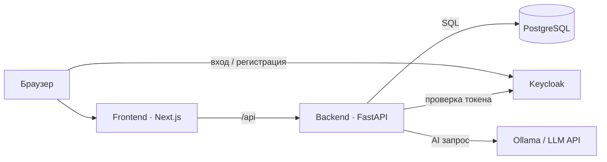

# Архитектура системы (6-сабақ)

**AI TestPlatform** — веб-платформа для преподавателей по автоматизированной генерации проверочных тестов с помощью ИИ и прохождению их учащимися с автоматическим подсчетом баллов.

---

## 1. Схема системы (Mermaid)

---

## 2. Компоненты системы

| Компонент | Что делает | Урок курса |
| :--- | :--- | :---: |
| **Frontend (Next.js)** | Пользовательский интерфейс: личный кабинет преподавателя (создание, редактирование тестов, аналитика) и адаптивный экран прохождения тестирования для студента. | 14 |
| **Backend (FastAPI)** | REST API, реализация бизнес-логики, слоистая архитектура (*Router → Schema → Service → Repository → Model*), проверка прав доступа и валидация данных. | 7–9 |
| **PostgreSQL** | Реляционная СУБД для надежного хранения данных: пользователей, тестов, вопросов и результатов попыток сдачи. | 8 |
| **Keycloak** | Централизованный сервис аутентификации (SSO, OAuth2 / OIDC). Управляет регистрацией, входом и выпуском JWT-токенов. Пароли в базу данных приложения не попадают. | 10 |
| **Ollama / LLM API** | Локальная или внешняя языковая модель для генерации формулировок вопросов, правдоподобных дистракторов и обучающих пояснений к ошибкам. | 13–14 |

---

## 3. Архитектурные решения

1. **Монолитный Backend вместо микросервисов:**
   - Система строится как единый монолит на базе FastAPI с одной базой данных PostgreSQL.
   - Для индивидуального проекта сроком разработки 8 недель микросервисы, очереди сообщений (Kafka/RabbitMQ) и Kubernetes избыточны и несут неоправданные затраты на поддержку.
2. **Внешняя аутентификация (Keycloak):**
   - Никаких паролей и хэшей в таблице `users`. Backend валидирует входящий заголовок `Authorization: Bearer <JWT>` через открытые ключи Keycloak.
3. **Безопасность образовательного контента:**
   - Правильные ответы (`correct_index`) хранятся в БД, но никогда не отдаются студенту до отправки финальной попытки. Подсчет баллов производится строго на сервере.
