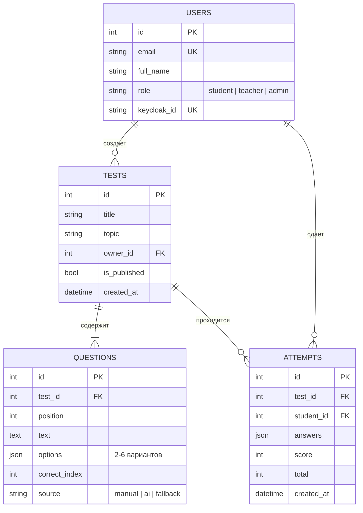

# Модель данных (ER-диаграмма — 6-сабақ)

Данная модель данных описывает структуру базы данных PostgreSQL для проекта **AI TestPlatform** и полностью покрывает все сценарии из `docs/user-stories.md`.

---

## 1. Таблицы (сущности)

- **`users`** — учетные записи пользователей системы (преподаватели и студенты).
  - `id` (int, PK) — уникальный идентификатор пользователя.
  - `email` (string, UK) — электронная почта.
  - `full_name` (string) — имя и фамилия пользователя.
  - `role` (string) — роль в системе (`teacher`, `student`, `admin`).
  - `keycloak_id` (string, UK) — внешний идентификатор из Keycloak.
  - *Примечание:* Поле `password` отсутствует, так как аутентификация и хранение паролей вынесены в Keycloak (10-й урок).

- **`tests`** — тесты, созданные преподавателями.
  - `id` (int, PK) — уникальный идентификатор теста.
  - `title` (string) — название теста (3–200 символов).
  - `topic` (string) — учебная тема или предмет.
  - `owner_id` (int, FK → `users.id`) — ссылка на преподавателя-автора теста.
  - `is_published` (bool) — статус публикации (по умолчанию `false`).
  - `created_at` (datetime) — дата и время создания.

- **`questions`** — тестовые вопросы, входящие в тест.
  - `id` (int, PK) — уникальный идентификатор вопроса.
  - `test_id` (int, FK → `tests.id`) — ссылка на тест, которому принадлежит вопрос.
  - `position` (int) — порядковый номер вопроса в тесте.
  - `text` (text) — текст задания / вопроса.
  - `options` (json) — массив вариантов ответов (от 2 до 6 вариантов).
  - `correct_index` (int) — индекс правильного варианта ответа.
  - `source` (string) — источник вопроса (`manual`, `ai`, `fallback`).

- **`attempts`** — попытки сдачи теста студентами (промежуточная таблица связи "многие ко многим").
  - `id` (int, PK) — уникальный идентификатор попытки.
  - `test_id` (int, FK → `tests.id`) — ссылка на сдаваемый тест.
  - `student_id` (int, FK → `users.id`) — ссылка на студента, сдавшего тест.
  - `answers` (json) — список выбранных студентом вариантов ответов.
  - `score` (int) — набранное количество баллов.
  - `total` (int) — максимально возможное количество баллов.
  - `created_at` (datetime) — дата и время сдачи теста.

---

## 2. Связи между таблицами

- **`users` 1 — много `tests`**: один преподаватель может создать множество тестов (`tests.owner_id → users.id`).
- **`users` 1 — много `attempts`**: один студент может сдать множество тестов / попыток (`attempts.student_id → users.id`).
- **`tests` 1 — много `questions`**: один тест содержит множество вопросов (`questions.test_id → tests.id`).
- **`tests` 1 — много `attempts`**: один тест может быть пройден множеством студентов (`attempts.test_id → tests.id`).
- **`users` ↔ `tests` (многие ко многим)**: студенты проходят тесты через промежуточную таблицу `attempts`.

---

## 3. ER-диаграмма (Mermaid)

